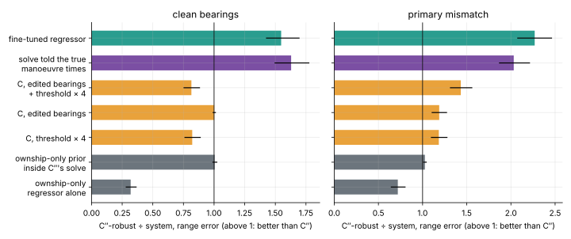
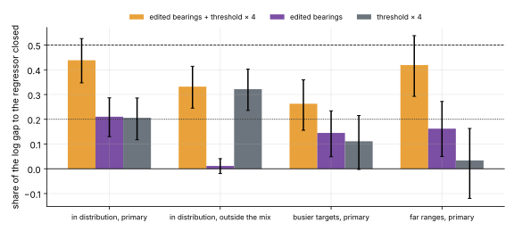

Spec 037 found a learned regressor twice as good as our classical real-time system under bearing
errors, and could not say why. Spec 038 tried to say why with nothing trained: it hardened the
classical segmenter by classical means, tested the simulator's prior on its own, and moved the
simulator's statistics. On a fresh test seed the hardening closes part of the gap at a cost on
clean data, the prior we could build explains nothing, and the review panel found that the
question of prior or bearings is still open. This post reports the readings and what the panel
made of them.

<!-- truncate -->

## What was done

- **Two classical controls around the frozen segmenter C.** Wild bearings edited out of what C
  sees, and C's confirmation threshold multiplied by four; each followed by the robust final
  solve. Settings were chosen on two spent seeds. C itself was not touched.
- **The prior on its own.** Spec 012's ownship-only regressor reads the ownship's track and no
  bearing feature. It was scored alone, and as a prior inside C″'s solve.
- **Splits where the simulator's statistics are moved.** Busier targets (shorter legs, smaller
  and faster turns) and far initial ranges (20 to 30 km), each with clean bearings and under
  spec 037's primary mismatch condition.
- **The test**: seed 372, 500 engagements on each of seven split and condition pairs, scored
  once, after the readings and their lines were registered
  (`experiments/20261127-gd-decision/`). No GPU time and no money.

"C″-robust" is C″ with Gate H's robust final solve. Ratios are paired per engagement, C″-robust
÷ the system, so above 1 the system is better.

## The registered readings

| | Reading | Test | Outcome |
|---|---|---|---|
| G | share of the gap to the regressor closed by the hardened control, primary mismatch | 0.44 [0.35, 0.53] | between |
| P | share of the regressor's gain obtained by the ownship-only prior in C″'s solve, clean | 0.01 [−0.02, 0.05] | little |
| P | the same, primary mismatch | 0.03 [0.01, 0.05] | little |
| S | the regressor's lead on busier targets ÷ in distribution, clean | 1.06 [0.94, 1.19] | not separated |
| S | the same, primary mismatch | 0.86 [0.76, 0.97] | shrinks |
| S | lead on far ranges ÷ in distribution, clean | 0.83 [0.75, 0.94] | shrinks |
| S | the same, primary mismatch | 0.75 [0.67, 0.84] | shrinks |

Beside them, in distribution:

| C″-robust ÷ system, range | clean | primary mismatch |
|---|---|---|
| fine-tuned regressor | 1.55 [1.43, 1.69] | 2.27 [2.08, 2.46] |
| robust solve told the true manoeuvre times | 1.63 | 2.03 |
| C with edited bearings and threshold × 4 | 0.82 [0.76, 0.88] | 1.43 [1.32, 1.56] |
| C with edited bearings | 1.00 | 1.19 |
| ownship-only prior inside C″'s solve | 1.01 | 1.03 |
| ownship-only regressor alone | 0.32 | 0.72 |

## What the panel made of it

Three reviewers recomputed the readings from the per-row errors and all three approved with
findings (`experiments/20261128-gd/review.md`). Every number reproduced. The first version of
the record said more than the data do, and was corrected.

**The 0.44 is a tail and a best case.** It is a share of the mean log gap, carried by about a
quarter of the engagements. The typical engagement closes about a quarter. The control gains a
great deal where C″ fails badly and loses a little elsewhere. By split the share is 0.26 to 0.44.
Pooled over clean and mismatched data it closes about 12%, and by the choice rule we registered
editing alone is the better control: 0.21 under mismatch at no clean-data cost. The clean-data
cost of the threshold is also a tail: no change for the median engagement, twice as bad in one
in five.

**The prior control was too weak to answer the question.** The ownship-only model has a median
range error of 0.33, and as a prior it barely moved C″'s solve at any weight. That is the same
fault spec 037's static prior had, and the spec had promised a control tight enough to move the
solve. So P says that the marginal prior given the ownship's track is worth nothing in a
classical solve. It does not say the regressor's gain is not prior knowledge.

**The data point the other way.** Against a robust solve that is told the true manoeuvre times,
the regressor wins in range where the bearings determine little (1.15 clean, 1.34 under
mismatch, in the loosest third of the bound) and loses where they determine much (0.77 and 0.93
in the tightest third; in course 0.51 and 0.71). Where it wins, its error is below the bound,
which only prior knowledge or the ceiling on a relative error can produce. That is what a prior
used together with the bearings would look like. It was not tested.

**Knowing the manoeuvre times is sufficient, which is not the same as the cause.** The solve
told the true times matches the regressor in range in distribution and beats it in course and
speed there and on every clean split. That does not show the regressor gets its gain by
segmenting.

**The split readings are mostly the yardstick moving.** Under mismatch the regressor holds its
ground against the solve told the true times on busier targets and far ranges (1.00, 0.94); what
shrinks is C″-robust's handicap. On clean data the regressor does lose ground to that solve
(0.84 on far ranges, 0.89 on busier targets). Its own range error rises 23 to 43% on busier
targets. We also wrote that the models had met the far ranges in training; they had not.

**The structure slice tests nothing.** Where C″'s declared manoeuvres match the truth at the
first scored row, C″-robust is still 1.5 times the solve told the true times on the later rows.
Spec 037's finding that the lead goes where C″'s segmentation holds is neither reproduced nor
refuted.

## What may be said

- Classical hardening of this small kind closes part of the gap under bearing errors: 0.44 of
  the mean log gap in distribution, about a quarter for the typical engagement, at a clean-data
  cost when the threshold is raised. Editing wild bearings alone is free and closes about a
  fifth.
- The marginal prior given the ownship's track is worth nothing inside C″'s solve.
- A solve told the true manoeuvre times is sufficient to match the regressor in range in
  distribution and to beat it in course and speed.

What may not be said: that the gain is not the prior, that the gain is segmentation, or that
classical methods cannot close the gap.

## What was not done

A prior control tight enough to move the solve; the ownship-only model by range; the slices on
the shifted and far splits in the record's own tables; the hybrid with the fine-tuned prior for
training seeds 2 and 3; thresholds above four with the edit; track plots.

## What follows

The panel's order, for the owner to choose from:

1. **Recommended: a causal classical estimator given the generator's own manoeuvre, speed and
   range priors**, on CPU and spent seeds first, read by how tight the bound is. This is the
   test the prior control was meant to be.
2. A better real-time segmenter, registered against the solve told the true times, which is 1.4
   to 2.0 ahead of the hardened control.
3. Only after the first: any further use of the regressor. Nothing is carried and no GPU run is
   made.

Wild-bearing editing in front of C is a candidate for a small follow-up on its own: it cost
nothing on clean data here. It is not adopted by this study.

The illustrated companion is the [slides post](/blog/2026/11/28/gain-decomposition-slides).
